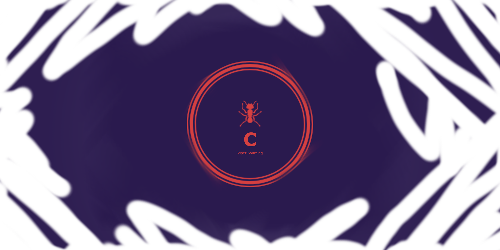

# Cerastes 

Project Ceragine is an early-stage interactive application framework and two-dimensional rendering engine made in Java. The engine was created for the Deep manga comic series and extends the Triumph engine prototype used to create an ant colony life simulator. It was created initially to satisfy a masters dissertation for Aberystwyth University's Computer Science Department and qualify for a degree in Advanced Computer Science. The Cerastes repository contains the source files and is regularly updated and maintained.
